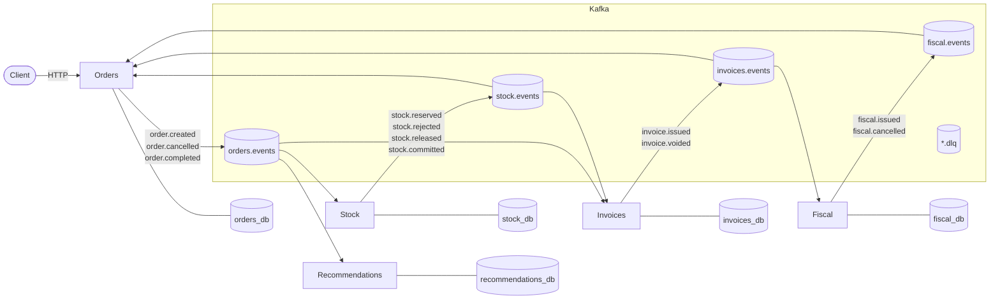
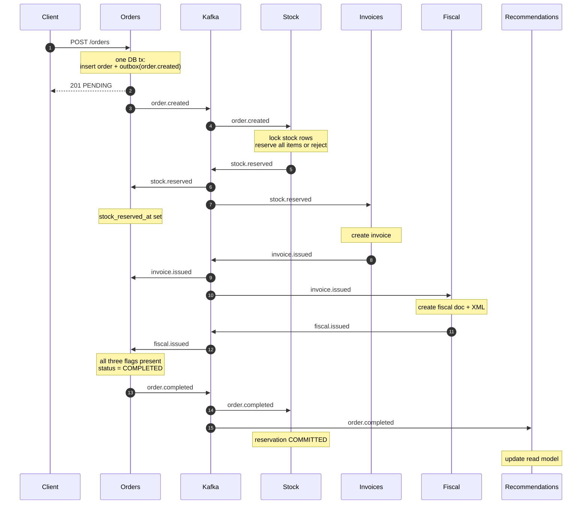

# Event-Driven Shop — Study Guide

This guide explains the project as a system design artifact, not just as code. Read it once end to end, run the demo, then use the failure scenarios and interview Q&A to rehearse.

---

## 1. The 60-second pitch

> I built a five-service e-commerce backend where the services communicate only through Kafka. Orders publish `order.created`; stock reserves inventory or rejects the order; invoices issue only after stock is reserved; fiscal generates a (simulated) fiscal document from the invoice; orders completes only when stock, invoice and fiscal confirmations all exist. Recommendations is a CQRS read model built from completed orders. Every service owns its own Postgres database, uses the transactional outbox pattern to publish reliably, and deduplicates events in an inbox table. The workflow is a choreographed saga with compensating events for cancellation and stock rejection.

That is the whole project. Everything below is the depth behind that paragraph.

---

## 2. What to run first

```bash
make up      # Kafka + Postgres + Kafka UI
make dev     # five FastAPI services (Terminal 1)
make demo    # end-to-end walkthrough (Terminal 2)
```

Then inspect:

- Kafka UI: <http://localhost:8080>
- Orders: <http://localhost:8001/docs>
- Stock: <http://localhost:8002/docs>
- Invoices: <http://localhost:8003/docs>
- Fiscal: <http://localhost:8004/docs>
- Recommendations: <http://localhost:8005/docs>

The demo intentionally takes a few seconds. Every arrow in the flow is a real Kafka hop: outbox poll → publish → broker → consumer poll → database transaction → next outbox poll. That delay is eventual consistency made visible.

---

## 3. Service ownership

| Service | Database | Owns | Consumes | Produces |
|---|---|---|---|---|
| **orders** | `orders_db` | order aggregate, item lines, saga timestamps | `stock.events`, `invoices.events`, `fiscal.events` | `orders.events` |
| **stock** | `stock_db` | stock levels, reservations | `orders.events` | `stock.events` |
| **invoices** | `invoices_db` | invoices, cancelled-order markers | `stock.events`, `orders.events` | `invoices.events` |
| **fiscal** | `fiscal_db` | fiscal documents, fake XML/access keys | `invoices.events` | `fiscal.events` |
| **recommendations** | `recommendations_db` | purchases, co-occurrence scores, popularity | `orders.events` | — |

Rules that hold throughout:

- A service reads and writes **only its own database**.
- There are **no service-to-service HTTP calls**. HTTP exists only at the edge, for clients.
- A service may expose read endpoints over its own data, but another service never calls them.
- Events are facts about the past, written in the past tense: `order.created`, `invoice.voided`.

The Postgres server is shared in local development only, to keep Docker light. Each service has a separate database, which is the logical boundary; production would normally use separate clusters for failure isolation.

---

## 4. High-level architecture



Every box is an independent process with its own database. The only shared thing is the event log.

---

## 5. Happy path, step by step



### 5.1 The HTTP write is small

`POST /orders` does only this, in one transaction (`services/orders/app/repository.py`):

1. calculate the total,
2. insert `orders` and `order_items`,
3. insert `order.created` into `outbox`,
4. commit,
5. return `201 PENDING`.

It does **not** call stock, wait for an invoice, or know whether the fiscal service exists. The request latency is independent of downstream services.

### 5.2 Each hop is another local transaction

When stock consumes `order.created` it:

1. verifies the order has no reservation yet,
2. locks all requested stock rows with `FOR UPDATE` in a stable order,
3. reserves every item or rejects the whole order,
4. writes the reservation and `stock.reserved` to its outbox in the same transaction.

No distributed transaction is needed. Each service makes an atomic local change and publishes a fact about it.

### 5.3 Completion is order-independent

Orders receives `stock.reserved`, `invoice.issued` and `fiscal.issued` from **three different topics**. Their delivery order is not guaranteed. Orders stores a timestamp/boolean for each and calls:

```sql
UPDATE orders
SET status = 'COMPLETED', completed_at = now()
WHERE id = $1
  AND stock_reserved_at IS NOT NULL
  AND invoice_issued_at IS NOT NULL
  AND fiscal_issued_at IS NOT NULL
  AND status IN ('PENDING', 'STOCK_RESERVED')
RETURNING ...
```

The `UPDATE` is the idempotency guard. Only the event that supplies the last missing fact can transition the order, so `order.completed` is emitted once.

---

## 6. Event catalogue

Every message uses the same envelope:

```json
{
  "event_id": "0f4e0b3a-5c1e-4f0f-9c6a-4d0f9d1a2b3c",
  "event_type": "order.created",
  "event_version": 1,
  "occurred_at": "2026-10-28T10:27:32.123456Z",
  "producer": "orders",
  "correlation_id": "2d0afc2f-152e-46ff-8024-5d4a004b4127",
  "causation_id": null,
  "partition_key": "2d0afc2f-152e-46ff-8024-5d4a004b4127",
  "payload": {
    "order_id": "2d0afc2f-152e-46ff-8024-5d4a004b4127",
    "customer_id": "alice",
    "items": [
      { "product_id": "p-100", "quantity": 1, "unit_price_cents": 12900 },
      { "product_id": "p-101", "quantity": 1, "unit_price_cents": 24900 }
    ],
    "total_cents": 37800,
    "currency": "USD",
    "created_at": "2026-10-28T10:27:32.123456Z"
  }
}
```

| Field | Why it exists |
|---|---|
| `event_id` | Deduplication key in the consumer inbox. |
| `event_type` | Routing and schema identification. |
| `event_version` | Schema evolution. Start at `1`. |
| `occurred_at` | Business time, not publish time. |
| `producer` | Ownership/debugging. |
| `correlation_id` | The whole business transaction (here: `order_id`). |
| `causation_id` | The `event_id` that directly caused this event. |
| `partition_key` | Kafka key, also visible to consumers. |
| `payload` | Facts. Keep it self-contained. |

### 6.1 Events in this system

| Event | Producer | Key payload fields | Consumed by |
|---|---|---|---|
| `order.created` | orders | order id, customer, items, total, currency, created_at | stock, invoices, recommendations |
| `order.cancelled` | orders | order id, customer, reason, items, cancelled_at | stock, invoices |
| `order.completed` | orders | order id, customer, items, totals, invoice id, fiscal id | stock, recommendations |
| `stock.reserved` | stock | order id, reservation id, **order snapshot**, reserved_at | orders, invoices |
| `stock.rejected` | stock | order id, reason, unavailable items | orders |
| `stock.released` | stock | order id, reservation id, items | orders, invoices (ignored) |
| `stock.committed` | stock | order id, reservation id | — |
| `invoice.issued` | invoices | invoice id/number, order id, customer, items, totals | orders, fiscal |
| `invoice.voided` | invoices | invoice id/number, order id, reason | orders, fiscal |
| `fiscal.issued` | fiscal | fiscal id, order id, invoice id, document number, access key | orders |
| `fiscal.cancelled` | fiscal | fiscal id, order id, invoice id, reason | orders |

A consumer **ignores unknown event types**. This is deliberate: sharing a topic must not turn an unrelated new event into a poison message. It is also why `invoices` can subscribe to `orders.events` and simply ignore `order.created` and `order.completed`.

Contracts are duplicated per service (`services/*/app/events.py`). That looks redundant, but it is consumer-driven contract ownership: each consumer validates only the fields it needs, and `extra="ignore"` allows producers to add fields without breaking it. A schema registry would centralize compatibility checks in a larger system.

---

## 7. Topic design

Topics are created explicitly by `broker/create_topics.py`:

| Topic | Partitions | Key | Producer | Consumer group(s) |
|---|---:|---|---|---|
| `orders.events` | 6 | `order_id` | orders | `stock-service`, `invoices-service`, `recommendations-service` |
| `stock.events` | 6 | `order_id` | stock | `orders-service`, `invoices-service` |
| `invoices.events` | 6 | `order_id` | invoices | `orders-service`, `fiscal-service` |
| `fiscal.events` | 6 | `order_id` | fiscal | `orders-service` |
| `<service>.dlq` | 1 | event key or `unknown` | same service | operators |

### 7.1 Why `order_id` is the key

Kafka guarantees ordering **within a partition**, not across a topic. With `order_id` as the key:

- `order.created` and a later `order.cancelled` for the same order land in the same partition and are consumed in order;
- all events for one order can be found in one partition when debugging;
- different orders spread across six partitions, allowing parallel consumers.

There is still **no ordering across topics**. `stock.reserved` can reach orders before `invoice.issued`, or an invoice can be issued while orders has not yet processed `stock.reserved`. The services must tolerate that, and they do, using flags plus conditional updates.

### 7.2 Consumer groups

Each service has one group id (`orders-service`, `stock-service`, …). Within a group, each partition is assigned to exactly one consumer. If you run two instances of the stock service, they split the six partitions; you cannot have more useful consumers than partitions.

Different groups are independent. `orders-service` and `invoices-service` both read `stock.events` from their own offsets.

### 7.3 Retention, replication and DLQs

- Event topics retain 7 days; DLQs retain 30 days.
- Local replication factor is 1 because there is one broker. Production: replication factor 3, `min.insync.replicas=2`, `acks=all`.
- Dead-letter topics keep poison messages for inspection instead of blocking a partition forever.

---

## 8. Pattern 1 — Transactional outbox

### 8.1 The dual-write problem

The naive implementation is:

```python
await db.execute("INSERT INTO orders ...")
await kafka.send("orders.events", event)
```

Two failure modes:

1. DB commits, process crashes before Kafka send → order exists, event lost, stock never reserves.
2. Kafka send succeeds, DB transaction rolls back → event exists for an order that does not.

You cannot make a Postgres transaction and a Kafka send atomic without a distributed transaction. The outbox removes the dual write from the request path.

### 8.2 How this project does it

`enqueue_event` writes the full envelope to the `outbox` table using the **same connection and transaction** as the business change:

```text
BEGIN
  INSERT INTO orders ...
  INSERT INTO order_items ...
  INSERT INTO outbox (envelope, topic, key) ...
COMMIT
```

The outbox table is created by shared platform DDL in `shared/edd_common/migrations.py`, so every service has one.

`OutboxRelay` (`shared/edd_common/outbox.py`) runs as a background task:

```sql
SELECT ...
FROM outbox
WHERE published_at IS NULL
ORDER BY created_at, id
LIMIT $1
FOR UPDATE SKIP LOCKED
```

For each row it publishes to Kafka and sets `published_at`. `SKIP LOCKED` lets multiple relay workers coexist without publishing the same row at the same time.

### 8.3 Delivery guarantee

The relay is **at-least-once**:

- Kafka send succeeds, then the DB update/commit fails → row stays unpublished → sent again.
- Producer idempotence (`enable_idempotence=True`, `acks=all`) protects against duplicate writes caused by broker retries within a producer session; it does **not** make the database update and Kafka send atomic.

So duplicates are expected and handled by consumers. This is the standard, honest answer in an interview: don't claim end-to-end exactly-once just because Kafka has transactions.

### 8.4 What the outbox buys you

- No lost events when the process dies at the wrong moment.
- Backpressure: if Kafka is down, rows accumulate; the HTTP write still succeeds.
- Retry and ordering are explicit and observable (`SELECT * FROM outbox WHERE published_at IS NULL`).
- The business transaction stays fast.

### 8.5 Production concerns

- **Multiple relay instances**: `SKIP LOCKED` prevents duplicate publishing, but two relays can publish different rows for the same key out of order. If per-key order matters, use one relay per service, or partition outbox work by key, or add a sequence and reorder downstream.
- **Cleanup**: this project never deletes published outbox rows. Production should archive/delete old rows in batches.
- **Polling vs CDC**: polling is simple and good enough here. Debezium/CDC reading the WAL avoids polling and can be lower-latency, at the cost of more infrastructure.
- **Outbox age**: alert on the oldest unpublished row, not just the count.

---

## 9. Pattern 2 — Idempotent consumer (inbox)

### 9.1 Why duplicates are normal

At-least-once delivery means the same event can be delivered more than once:

- relay republished after a failed `published_at` update;
- consumer processed the handler but crashed before committing the offset;
- broker redelivery after a rebalance.

### 9.2 How this project deduplicates

Before running a handler, the consumer inserts into `processed_events`:

```sql
INSERT INTO processed_events (event_id, consumer_group, event_type)
VALUES ($1, $2, $3)
ON CONFLICT (event_id, consumer_group) DO NOTHING
RETURNING event_id
```

If `RETURNING` yields nothing, the event is a duplicate and the handler is skipped. The insert and the handler run in **one Postgres transaction**. If the handler fails, both roll back, so a retry can process the event again.

The primary key is `(event_id, consumer_group)` because the same event can legitimately be processed by several services.

### 9.3 Offset commit order

The consumer uses manual commits (`enable_auto_commit=False`). The order is:

```text
poll message
BEGIN
  claim event_id in processed_events
  run handler (business write + outbox insert)
COMMIT
commit Kafka offset
```

If the process dies:

- before DB commit → no state change, offset not committed → redelivery, retry;
- after DB commit, before offset commit → state changed, offset not committed → redelivery, inbox detects duplicate, skipped.

Committing the offset before the DB transaction would allow losing an event if the crash happened in between. This ordering is the critical detail.

### 9.4 Business idempotency beyond `event_id`

The recommendations service adds another layer. It marks each completed order in `processed_orders`. If an operator republishes an equivalent `order.completed` with a **new** `event_id`, the inbox would not catch it, but the business marker does, so co-occurrence scores are not double-counted.

Unique constraints are the third layer: `reservations.order_id`, `invoices.order_id`, `fiscal_documents.invoice_id`, and so on.

### 9.5 What is still not exactly-once

If a handler sends an email, charges a card, or calls an external API, a crash between that side effect and the DB commit can repeat the side effect. The inbox only makes **database effects** effectively-once. External systems need idempotency keys or their own deduplication.

---

## 10. Pattern 3 — Choreographed saga with compensation

### 10.1 State machine

```text
                 order.created
                       │
                       ▼
                   PENDING ──────────────┐
                       │                 │
             stock.reserved              │ stock.rejected
                       ▼                 │
                STOCK_RESERVED           │
                       │                 │
     invoice.issued + fiscal.issued      │
                       ▼                 ▼
                  COMPLETED          CANCELLED
```

There is no `INVOICED` status. The order keeps independent timestamps (`stock_reserved_at`, `invoice_issued_at`, `fiscal_issued_at`) and completes when all three exist. This avoids a fragile linear status machine when events arrive from different topics in different orders.

### 10.2 Who reacts to what

| Trigger | Service | Reaction | Emits |
|---|---|---|---|
| `order.created` | stock | reserve all items or reject | `stock.reserved` / `stock.rejected` |
| `stock.reserved` | invoices | create invoice | `invoice.issued` |
| `invoice.issued` | fiscal | create fiscal document | `fiscal.issued` |
| `stock.reserved` / `invoice.issued` / `fiscal.issued` | orders | record flag; complete when all present | `order.completed` |
| `order.completed` | stock | commit reservation (`reserved -= qty`) | `stock.committed` |
| `order.completed` | recommendations | update read model | — |
| `stock.rejected` | orders | cancel order | `order.cancelled` |
| `order.cancelled` | stock | release reservation | `stock.released` |
| `order.cancelled` | invoices | remember cancellation; void invoice if issued | `invoice.voided` |
| `invoice.voided` | fiscal | cancel fiscal document | `fiscal.cancelled` |

### 10.3 Compensation, not rollback

There is no distributed rollback. Each service performs a new, forward action that reverses its previous action:

- stock: `RESERVED → RELEASED` (available += quantity, reserved -= quantity);
- invoice: `ISSUED → VOIDED`;
- fiscal: `ISSUED → CANCELLED`;
- order: `PENDING/STOCK_RESERVED → CANCELLED`.

These are semantic compensations. You cannot “un-send” a Kafka message; you publish another fact.

### 10.4 The hard part: races

Distributed sagas fail in the seams. This project handles several races explicitly:

**A. `stock.reserved` arrives after the customer cancelled.**
Orders already has `status = 'CANCELLED'`. The handler records the reservation timestamp but the completion `UPDATE` excludes `CANCELLED`, so the order cannot jump back to `COMPLETED`. Stock still receives `order.cancelled` and releases.

**B. Cancellation arrives before stock has reserved.**
Both events are keyed by `order_id` in `orders.events`, so stock sees `order.created` before `order.cancelled`. It reserves, then releases. The final state is still `RELEASED`.

**C. Cancellation and stock rejection race.**
Both try to cancel. Orders uses `WHERE status NOT IN ('CANCELLED', 'COMPLETED') RETURNING ...`; only one wins, so `order.cancelled` is emitted once. The other path sees no row and stops.

**D. Invoice issuance races with cancellation.**
Invoices persists every cancellation in `cancelled_orders`. When `stock.reserved` arrives it first checks that table. If the cancellation was already seen, it skips issuing. If the invoice was already issued, the cancellation handler voids it. Either order of arrival converges.

**E. Invoice is issued, then cancelled before fiscal processes it.**
`invoice.issued` and `invoice.voided` share the same partition key and topic, so fiscal processes them in order: create the document, then cancel it.

**F. Stock is over-sold by two orders.**
Stock locks all product rows with `FOR UPDATE` in sorted order, checks availability in Python, and updates all rows only if every item is available. All-or-nothing reservation prevents partial reservations and lock-order deadlocks.

### 10.5 Choreography vs orchestration

| | Choreography (this project) | Orchestration |
|---|---|---|
| Coordination | Each service reacts to facts | A central saga orchestrator sends commands |
| Coupling | Services know event types, not each other | Orchestrator knows every step |
| Visibility | Emergent; harder to see the whole flow | Explicit state machine in one place |
| Change | Add a consumer without touching others | Change the orchestrator |
| Failure handling | Distributed compensation | Central retry/compensation policy |

Choreography is excellent for simple, well-understood flows with few steps. At 10+ steps, an orchestrator (Temporal, Camunda, AWS Step Functions, or a dedicated service) is often easier to reason about. A strong interview answer mentions both and explains why you chose one.

### 10.6 Where a payment step would go

A real system would insert payment after stock reservation (or before, depending on the business):

```text
stock.reserved → payments.authorized → invoices.issued → fiscal.issued → completed
                       │
                       └── payments.declined → order.cancelled → stock.released
```

The same guard/compensation rules apply. Payment is a classic external side effect that needs an idempotency key.

---

## 11. Pattern 4 — Event-carried state transfer

`stock.reserved` carries the order snapshot it received:

```json
{
  "order_id": "...",
  "reservation_id": "...",
  "customer_id": "alice",
  "items": [...],
  "total_cents": 37800,
  "currency": "USD",
  "reserved_at": "..."
}
```

Invoices needs the customer, items and total to issue an invoice. It could call orders over HTTP (forbidden here), or subscribe to `order.created` and keep a local order snapshot, or receive the data in the event. This project uses event-carried state transfer.

**Pros**
- No synchronous dependency; invoices works even if orders is down.
- One event is enough; no “wait for two events” race.
- Consumers can process historical events without querying current state.

**Cons**
- Duplicated data and larger payloads.
- The producer's event shape now includes fields another service cares about; ownership is less crisp.
- Sensitive data (PII) can leak into topics; think about minimization and retention.
- If the snapshot needs to change, you have a schema-evolution problem.

An alternative is a **local materialized snapshot**: invoices consumes `order.created`, stores its own copy keyed by order id, and issues when `stock.reserved` arrives. That avoids duplicating data in the stock event but introduces a two-event join and the need to handle “reserved arrived before created” (defer, retry, or store pending events). Both are valid; be ready to discuss the trade-off.

---

## 12. Pattern 5 — CQRS read model (recommendations)

Recommendations never asks another service for data. It subscribes to `order.completed` and builds its own projection:

- `user_purchases`: what each customer bought.
- `product_cooccurrence`: for every pair of distinct products in an order, increment both directions.
- `product_popularity`: units and order counts, used as a fallback.

At query time:

1. fetch the user's purchased products;
2. sum co-occurrence scores for related products the user has not bought;
3. fill the remaining slots with globally popular products;
4. return `reason: bought_together` or `reason: popular`.

This is a read model optimized for the query, not a normalized copy of the write model. It demonstrates **CQRS**: the write side (orders) and read side (recommendations) have different schemas and are connected asynchronously.

Implications:

- **Eventual consistency**: a just-completed order may not appear instantly.
- **Replayability**: in principle you can rebuild the projection by replaying `order.completed`. In this project, `processed_orders` prevents double-counting; a true rebuild would clear the projection and its markers first.
- **Scale**: co-occurrence grows with product pairs. For a large catalogue, you would use approximate algorithms, embeddings, or a dedicated recommender, and precompute per user.
- **No personalization beyond purchases**: it is intentionally simple.

---

## 13. Consistency and the client experience

`POST /orders` returns `201 PENDING` immediately. Then the order moves through states asynchronously. The client must poll `GET /orders/{id}` or subscribe to updates.

This is the classic event-driven trade-off:

- **Availability and latency**: the write succeeds even if stock, invoices or fiscal are down.
- **Eventual consistency**: the order is not immediately `COMPLETED`; an invoice may not exist yet.
- **Read-your-writes**: the order itself is readable immediately (same service/database), but downstream projections are not.

Ways to improve the client experience:

- return `202 Accepted` with a status URL (`Location: /orders/{id}`);
- expose SSE/WebSocket updates;
- include a saga status/step field;
- use an idempotency key on the POST so retries do not create duplicate orders;
- add a timeout/expiry: if no stock decision within N minutes, cancel with a reason.

This project exposes the raw state so you can watch the transitions.

---

## 14. Delivery semantics and failure matrix

### 14.1 Vocabulary

- **At-most-once**: may lose messages, never duplicate. Rarely acceptable.
- **At-least-once**: may duplicate, never lose. This project.
- **Exactly-once**: no loss, no duplicates. Kafka can do this within Kafka (transactions, idempotent producer), but not atomically with an external database without additional work.
- **Effectively-once**: at-least-once delivery plus idempotent consumers. This is what you actually get end to end.

### 14.2 Failure matrix

| Failure | What happens | Why it is safe |
|---|---|---|
| Process dies before DB commit | No state change, offset not committed | Event redelivered, handler retried |
| Process dies after DB commit, before offset commit | State changed, offset not committed | Redelivery hits inbox duplicate, skipped |
| Kafka send succeeds, outbox mark fails | Event published, row stays pending | Republished later; consumer deduplicates |
| Kafka is unavailable | Outbox rows accumulate; relay retries; HTTP writes still work | Backpressure, no data loss |
| Consumer is down | Kafka retains events; consumer lag grows | Restart resumes from committed offset |
| Database is down | Consumer cannot process; relay cannot mark published | Offsets not committed; retries |
| Handler throws (transient) | Transaction rolls back; retries with backoff | No partial state |
| Handler throws (poison) | Retries exhausted; event goes to DLQ; offset committed | Partition continues |
| Invalid JSON/envelope | Sent to DLQ | Does not crash the consumer |
| Duplicate event | Inbox skip | No double effect |
| Events arrive out of order across topics | Flags/guards; conditional updates | Converges to a valid state |
| Cancellation after completion | HTTP returns `409` | Completed orders are immutable |
| Consumer group rebalance | Offsets committed; uncommitted messages redelivered | Inbox dedupe |

### 14.3 Retry policy

`EventConsumer` retries a failing handler three times with exponential backoff (0.25s, 0.5s, 1s). After that, it publishes to `<service>.dlq` and commits the offset. A DLQ message contains the consumer group, topic, partition, offset, error and original event. This is a **starting point**, not a production policy: you would add metrics, alerting, replay tooling, and possibly non-retryable error classification.

### 14.4 Why not use Kafka transactions everywhere?

Kafka transactions can atomically write to multiple Kafka topics and commit consumer offsets. They cannot include a Postgres commit. Since the business state lives in Postgres, you still need the inbox/outbox bridge. Kafka transactions would mainly help in a pure Kafka-to-Kafka pipeline (stream processing).

---

## 15. Ordering, partitions and concurrency

### 15.1 What is guaranteed

- Same topic + same key → same partition → ordered delivery.
- Different keys → potentially different partitions → no ordering.
- Different topics → no ordering, even with the same key.

### 15.2 What the code does about it

- All order-related events use `order_id` as the partition key.
- Per-service outbox relay publishes in `created_at, id` order, so per-key order is preserved for a single service instance.
- Completion uses three independent flags, not an assumed sequence.
- Invoices stores cancellation markers to handle whichever topic wins.
- Stock uses row locks and all-or-nothing reservation.
- Orders and invoices use conditional `UPDATE ... WHERE status ... RETURNING` as compare-and-set guards.

### 15.3 Scaling partitions

Six partitions per event topic means up to six consumers per group. With one consumer, it reads all six. If you scale stock to three instances, each gets two partitions; ordering per order is preserved because a key always maps to one partition. You cannot get more parallelism than partitions without changing the key or increasing partition count (which changes key→partition mapping; do it deliberately).

### 15.4 Hot keys

A single very active customer or product could create hot partitions. Orders are keyed by order id, which spreads well. If you keyed by customer id, a celebrity customer could hot-spot. If you keyed by product id, a flash sale could hot-spot. Choose the key based on the ordering domain and load distribution.

### 15.5 Multiple outbox relays

As noted in §8.5, scaling a service to multiple instances gives each instance its own relay. `SKIP LOCKED` prevents duplicate publishing but not reordering of different rows for the same key. Production options:

- one relay deployment per service (not per application instance);
- assign outbox rows to relays by key hash;
- add a monotonic sequence per key and have consumers buffer/reorder;
- use CDC with partition-aware ordering.

This is a subtle and impressive point to raise in an interview.

---

## 16. Scaling and operations

### 16.1 Throughput

- Increase partitions to increase consumer parallelism (plan for future growth; repartitioning is disruptive).
- Batch database writes where possible (stock currently updates one row per item; a bulk update would be faster).
- Tune producer `linger_ms`, batch size, compression.
- Keep consumer handlers fast; move slow work to another stage if needed.
- Use connection pooling (asyncpg pool per service).

### 16.2 Consumer lag

Lag = latest offset − committed offset. Alert on sustained lag and on **lag age**, not just message count. A lag of 10k messages may be fine; a lag of 10k messages that are 30 minutes old is not.

### 16.3 Outbox health

Alert on the oldest unpublished outbox row. A growing outbox means Kafka is unavailable or the relay is stuck. This is a leading indicator of lost freshness, even though data is not lost.

### 16.4 Broker production checklist

- 3+ brokers, replication factor 3, `min.insync.replicas=2`, `acks=all`.
- Rack/AZ awareness.
- Disk sizing for retention and throughput.
- Monitoring: under-replicated partitions, controller health, request latency, disk usage.
- Separate clusters or quotas for noisy tenants.
- Schema registry and topic ACLs.

### 16.5 Database per service

Locally, one Postgres server hosts five databases. In production, separate clusters (or at least separate credentials/roles) provide failure isolation and independent scaling. The important design rule is that no service reads another service's tables.

### 16.6 Deployment

- Services are stateless; scale horizontally.
- Run migrations before starting new code (or use an init job), not on every replica if that causes races. This project's migration runner is safe enough for a single instance but would need a lock for many replicas.
- Rolling deploys can run old and new consumers simultaneously; contracts must be backward compatible during the overlap.

---

## 17. Observability

The envelope already gives you the two most important identifiers:

- `correlation_id` = the business transaction (`order_id`);
- `causation_id` = the event that triggered this one.

Logs include event id and correlation id when processing. To trace a whole order:

```bash
grep <order_id> .run/*.log
```

In production, add:

- **Metrics**: consumed/produced counts, handler duration, errors, retries, DLQ count, consumer lag, outbox pending/age, DB latency.
- **Tracing**: OpenTelemetry with Kafka header propagation (`traceparent`), spans for consume → DB → outbox → publish.
- **Dashboards**: per-topic lag, per-service error rate, saga completion time, cancellation/rejection rate.
- **Alerts**: oldest outbox row, sustained lag, DLQ growth, completion time SLO, 5xx rate.
- **Audit**: events are an immutable log; retain them according to policy.

The current health endpoint checks the database. A readiness check could also verify Kafka producer/consumer connectivity.

---

## 18. Security

Intentionally omitted to keep the study project focused:

- API authentication/authorization (OAuth2/JWT, API gateway).
- Kafka TLS/SASL and per-topic ACLs.
- Encryption at rest and in transit.
- PII minimization in events; data retention/GDPR.
- Secrets management (not in env files).
- Rate limiting and input validation at the edge (basic validation exists).
- Audit access to DLQs and admin endpoints (restock is unauthenticated here).

In an interview, mention these as production concerns rather than pretending the demo is complete.

---

## 19. Schema evolution

Strategies used here:

- `event_version` in the envelope.
- Additive fields only; consumers use `extra="ignore"`.
- Each service owns its consumer-side contract models.
- Unknown event types are ignored.
- DLQ catches payloads that fail validation.

In a larger system:

- use a schema registry (Avro/Protobuf/JSON Schema) with backward-compatibility checks;
- never change the meaning of an existing field;
- add optional fields with defaults;
- introduce `event_type.v2` only for breaking changes and run both during migration;
- version the topic if necessary (`orders.events.v2`);
- keep old consumers working during rolling deploys;
- have a replay/backfill plan.

---

## 20. What this project deliberately simplifies

Be honest about this in interviews — it signals maturity.

| Simplification | Production alternative |
|---|---|
| Prices come from the client | Product catalogue/pricing service; server-side price validation |
| No payment service | Payment authorization + compensation; idempotency keys |
| One warehouse | Per-warehouse stock, allocation rules |
| No shipping/fulfilment | Shipping saga, tracking events |
| One Kafka broker, RF=1 | 3+ brokers, RF=3, min ISR, rack awareness |
| One Postgres server | Separate clusters per service, backups, failover |
| No auth on APIs | AuthN/AuthZ, gateway, quotas |
| No HTTP idempotency key | Store key → result; return the original response |
| Published outbox rows never deleted | Batch archival/cleanup job |
| DLQ has no replay tool | Ops tool to inspect, fix, replay, or discard |
| Fake fiscal document | Real tax integration, signing, retries |
| Migrations run at app startup | Migration job with advisory lock in CI/CD |
| Single instance per service | Multiple replicas, autoscaling, leader-aware relay |
| In-process consumers | Dedicated worker deployments (API and consumer scale differently) |
| No integration tests | Testcontainers, contract tests, chaos tests |
| No schema registry | Confluent/Redpanda schema registry or Glue |
| Co-occurrence in Postgres | Offline recommender, embeddings, feature store |

The demo is intentionally a **learning instrument**, not a claim that five services are always better than a modular monolith.

---

## 21. When not to use event-driven architecture

Use synchronous calls or a modular monolith when:

- the flow is simple and request/response is natural;
- the client needs an immediate, consistent answer;
- the team is small and operational overhead dominates;
- you cannot tolerate eventual consistency in the domain;
- you do not need independent scaling or failure isolation;
- you lack observability and replay tooling.

Event-driven shines when:

- multiple consumers care about the same fact;
- producers and consumers should scale/deploy independently;
- work can be asynchronous (invoicing, email, analytics, projections);
- you need a durable audit log and replay;
- downstream outages should not block writes.

The right interview answer is not “microservices and Kafka everywhere”; it is “here is the coupling, consistency and operational trade-off, and here is why it fits this domain.”

---

## 22. Hands-on experiments

### 22.1 Watch the saga in the database

```bash
docker compose exec postgres psql -U shop -d orders_db \
  -c "select id, status, stock_reserved_at, invoice_issued_at, fiscal_issued_at, completed_at from orders order by created_at desc limit 5;"

docker compose exec postgres psql -U shop -d stock_db \
  -c "select * from reservations order by created_at desc limit 5;"

docker compose exec postgres psql -U shop -d invoices_db \
  -c "select invoice_number, status, void_reason from invoices order by issued_at desc limit 5;"

docker compose exec postgres psql -U shop -d recommendations_db \
  -c "select * from product_cooccurrence order by score desc limit 10;"
```

Inspect the outbox and inbox:

```bash
docker compose exec postgres psql -U shop -d orders_db \
  -c "select event_type, published_at is not null as published from outbox order by created_at desc limit 10;"

docker compose exec postgres psql -U shop -d orders_db \
  -c "select consumer_group, event_type, count(*) from processed_events group by 1,2 order by 3 desc;"
```

### 22.2 Inspect Kafka

```bash
docker compose exec kafka /opt/kafka/bin/kafka-topics.sh \
  --bootstrap-server localhost:9092 --list

docker compose exec kafka /opt/kafka/bin/kafka-topics.sh \
  --bootstrap-server localhost:9092 --describe --topic orders.events

docker compose exec kafka /opt/kafka/bin/kafka-consumer-groups.sh \
  --bootstrap-server localhost:9092 --describe --group orders-service

docker compose exec kafka /opt/kafka/bin/kafka-console-consumer.sh \
  --bootstrap-server localhost:9092 --topic orders.events \
  --from-beginning --property print.key=true --max-messages 5
```

### 22.3 Kill a consumer and watch catch-up

Using the full Docker profile:

```bash
docker compose --profile apps stop stock
# place an order; it stays PENDING because no stock.reserved arrives
docker compose --profile apps start stock
# stock resumes from its committed offset, reserves, and the saga continues
```

The order is not lost while stock is down. That is the availability benefit of the broker.

Restarting a consumer can take up to the Kafka session timeout (30s in this project) before the group rebalance completes and the service becomes ready again. That is one reason the health endpoint alone is not enough for readiness in production: you also want to check consumer group membership and lag.

### 22.4 Crash between commit and offset commit

Hard to do precisely, but you can simulate duplicate handling by publishing the same event twice. Consume an event from a topic, then produce it again and watch the consumer log `Skipping duplicate event`. A simple Python producer/consumer script using `aiokafka` is enough.

### 22.5 Force a poison message

Produce invalid JSON to `orders.events` (or a payload missing required fields). The consumer will retry and then write to `stock.dlq` / the appropriate DLQ. Inspect it with the console consumer.

### 22.6 Watch consumer lag

```bash
docker compose exec kafka /opt/kafka/bin/kafka-consumer-groups.sh \
  --bootstrap-server localhost:9092 --describe --all-groups
```

Stop a service, create orders, and watch `LAG` grow.

### 22.7 Rebuild the recommendation projection

```sql
TRUNCATE user_purchases, product_cooccurrence, product_popularity, processed_orders;
```

Then replay `orders.events` from the beginning into a fresh `recommendations-service` group (or reset its offsets). Because only `order.completed` is projected, the read model is rebuilt from facts.

### 22.8 Add a new consumer without touching producers

Create a small service (or script) in the group `analytics-service` that consumes `order.completed` and counts revenue. This demonstrates the fan-out benefit: no producer change, no new HTTP endpoint, no coordination.

---

## 23. Interview Q&A

**Q: Why did you choose event-driven architecture here?**
Because several independent concerns react to the same order fact (stock, invoice, fiscal, recommendations), and downstream failures should not block order creation. Kafka also gives durability, replay, and fan-out. I would not use it for a simple CRUD app.

**Q: How do you guarantee an event is published when the database changes?**
Transactional outbox. The business row and the event row commit in the same Postgres transaction; a relay publishes unpublished rows with `SKIP LOCKED` and marks them. Delivery is at-least-once, and consumers deduplicate.

**Q: Exactly-once?**
End-to-end exactly-once across Postgres and Kafka is not free. Kafka’s idempotent producer prevents broker-level duplicates, and transactions work within Kafka, but the database commit is outside. I use at-least-once plus an inbox table and business-level idempotency for effectively-once processing. External side effects still need idempotency keys.

**Q: How do you handle duplicate events?**
`processed_events` has `(event_id, consumer_group)` as primary key. The claim and the business change are in one transaction. Duplicate offset redelivery is skipped. Unique constraints and markers like `processed_orders` add business-level protection.

**Q: How do you order events?**
Partition key is `order_id`, so events for one order are ordered within a topic. Across topics there is no order guarantee, so the saga uses flags, conditional updates and cancellation markers instead of assuming sequence.

**Q: What happens if stock is down?**
Orders still accepts the order and publishes `order.created`. Stock’s consumer group lags; when it recovers it processes the backlog. The order stays `PENDING` until then. If a business timeout is required, add expiry/cancellation.

**Q: What if stock rejects?**
Stock writes `stock.rejected`; orders cancels and emits `order.cancelled`; stock/invoices/fiscal compensate if needed. The client sees `CANCELLED` with the reason.

**Q: How do you cancel after an invoice exists?**
`order.cancelled` triggers `invoice.voided`, then `fiscal.cancelled`, and stock releases the reservation. Each service compensates its own state. Orders refuses cancellation after completion.

**Q: Why not 2PC/distributed transactions?**
They require locking across services, are slow and fragile, and most brokers/queues do not participate. Sagas with local transactions and compensation are the practical alternative.

**Q: Choreography vs orchestration?**
Choreography is simple and decoupled for a short flow, but the overall state is emergent. An orchestrator makes complex flows and retries explicit. I chose choreography because this saga has five steps and each service naturally owns its reaction.

**Q: How is the read model kept consistent?**
It is eventually consistent. Recommendations consumes `order.completed` and updates its own tables. This is CQRS; the query side is optimized for reads and can be rebuilt by replay.

**Q: How do you evolve event schemas?**
Additive changes, defaults, `extra="ignore"`, `event_version`, and a schema registry in production. Never change the meaning of a field. For breaking changes, publish a new event type/version and run both during migration.

**Q: How do you scale consumers?**
Increase partitions and consumer instances up to the partition count. Keys preserve per-order ordering. Monitor lag and per-partition skew. Beware hot keys.

**Q: What is the biggest operational risk?**
The outbox relay and consumer lag. I would alert on oldest unpublished outbox row, sustained lag age, DLQ growth, and saga completion time. Also schema drift between producers and consumers.

**Q: How do you test this?**
Unit-test handlers and contracts; integration-test with Testcontainers (Postgres + Kafka); contract-test producers/consumers; chaos-test by stopping services/brokers; assert idempotency by replaying duplicates; verify compensation paths.

**Q: Is this event sourcing?**
No. Event sourcing stores the aggregate’s state as a sequence of events and rebuilds it from the log. Here events are integration facts between services; each service stores current state in Postgres. The outbox is not an event store.

**Q: How do you handle a poison message?**
Retry a few times, then publish to a DLQ with error context and commit the offset. Alert, inspect, fix, and replay. Never let one message block a partition forever.

**Q: How do you prevent lost updates in stock?**
Lock rows with `FOR UPDATE` in a deterministic order, check availability, and update all rows or none. The reservation is a single local transaction.

**Q: How would you add payments?**
Add a payment service and events (`payment.authorized`, `payment.declined`). Insert it after stock reservation. On decline, emit `order.cancelled` and compensate stock. Use an idempotency key with the payment provider.

**Q: How do you make the client see updates faster?**
Return `202` with a status URL, poll with backoff, or push via SSE/WebSocket. Add saga step/status to the response. Keep the write asynchronous.

**Q: Why is there a single Postgres server in the demo?**
For local convenience. The logical boundary is one database per service; production would use separate clusters with independent backups/failover. No service reads another's tables.

**Q: What would you change for 100× traffic?**
More partitions and brokers, batch writes, separate consumer deployments, outbox cleanup and relay sharding, schema registry, caching for reads, precomputed recommendations, and load testing with lag SLOs. Possibly move recommendations to a stream processor.

---

## 24. Five-minute whiteboard script

If an interviewer says “walk me through a system you built”:

1. **Problem and scope** (30s): five-service e-commerce order flow, Kafka-only communication, Postgres per service.
2. **Draw the flow** (90s): orders → stock → invoices → fiscal → orders completion; recommendations as a side projection.
3. **Reliability** (60s): outbox, inbox, at-least-once, manual offsets, DLQ, idempotent business keys.
4. **Consistency** (60s): choreographed saga, compensation, cross-topic races, conditional updates.
5. **Trade-offs** (60s): eventual consistency, operational complexity, when a monolith/sync calls are better, what is simplified.
6. **Scale/ops** (30s): partitions, consumer groups, lag, outbox age, schema registry, tracing.

Then invite a follow-up: “The most interesting failure is cancellation racing with invoice issuance — want me to walk through it?” That is where the project stands out.

---

## 25. Glossary

| Term | Meaning |
|---|---|
| **Event** | An immutable fact about something that happened. |
| **Command** | A request to do something; may be rejected. Not used between services here. |
| **Producer** | Service that writes events. |
| **Consumer** | Service that reads events. |
| **Topic** | Durable, partitioned log in Kafka. |
| **Partition** | Ordered shard of a topic; ordering is per partition. |
| **Key** | Determines the partition; `order_id` here. |
| **Consumer group** | Consumers sharing partitions and offsets; one group per service. |
| **Offset** | Position in a partition; committed after processing. |
| **Outbox** | Table storing events in the same transaction as state changes. |
| **Inbox** | Table storing processed event ids for deduplication. |
| **Saga** | Multi-service workflow with local transactions and compensations. |
| **Choreography** | Services react to events; no central coordinator. |
| **Orchestration** | A coordinator drives the steps. |
| **Compensation** | A new action that semantically reverses a previous action. |
| **CQRS** | Separate write and read models. |
| **Event sourcing** | State derived from an event log; not the same as event-driven. |
| **Eventual consistency** | Replicas/projections converge over time, not instantly. |
| **DLQ** | Dead-letter queue/topic for messages that cannot be processed. |
| **Idempotent** | Applying the same operation twice has the same effect as once. |
| **Correlation id** | Identifier for the whole business transaction. |
| **Causation id** | Identifier of the event that caused this one. |
| **At-least-once** | Delivery may duplicate but not lose. |
| **Effectively-once** | At-least-once + idempotent processing. |

---

## 26. Ten things to remember

1. **Events are facts; commands are requests.** This system moves facts.
2. **No distributed transaction.** Each service commits locally and publishes through its outbox.
3. **At-least-once is the default.** Deduplicate in the consumer, do not wish duplicates away.
4. **Commit offsets after the database transaction**, never before.
5. **Partition by the ordering domain.** Here, `order_id`.
6. **Cross-topic ordering does not exist.** Use flags, guards and markers.
7. **Sagas compensate; they do not roll back.**
8. **CQRS read models are eventually consistent** and can be rebuilt from events.
9. **A DLQ is not a graveyard**; it needs alerting, inspection and replay.
10. **The hard part is operations**, not the happy path: lag, outbox age, schema evolution, tracing, and failure drills.

If you can explain those ten points with this codebase as evidence, you can hold your own in a system design interview.
